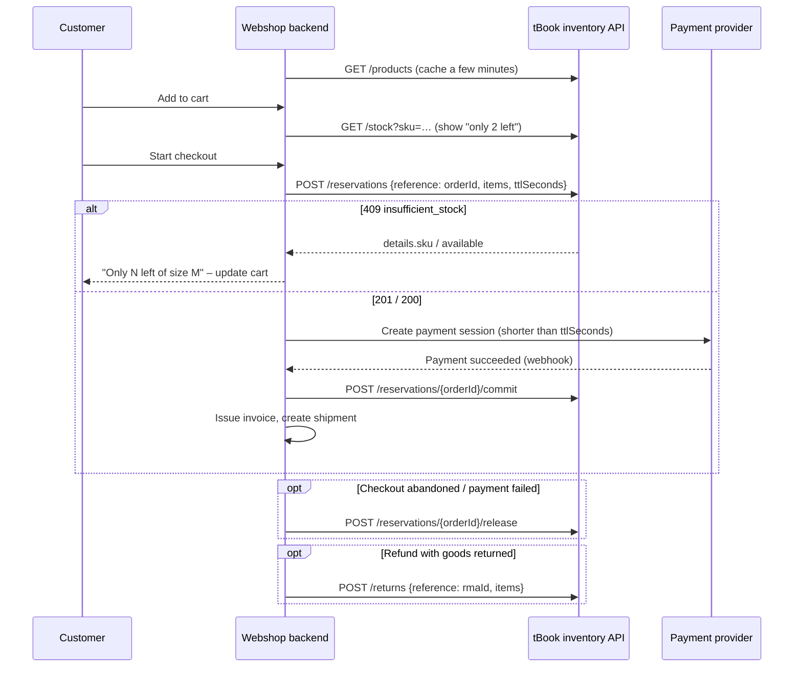

# Inventory API — products and shared stock

tBook is the **single source of truth for merchandise and its stock**. The
counter (point of sale, in the tBook console) and the webshop sell from the
same stock, so a T-shirt sold at the event can't also be sold online.

| Lives in tBook | Lives in the webshop |
|---|---|
| Products, variants (size/colour), SKUs, prices, VAT | Cart, checkout, customer accounts |
| Stock: available / reserved / on hand | Orders, order status, order history |
| Reservations (holds during checkout) | Payment (Stripe etc.) |
| Stock movement log (every change, every channel) | Invoicing (Számlázz.hu etc.) |
| Counter sales + Számlázz.hu receipts (nyugta) | Shipping, parcel labels, tracking |
| | Refunds (and telling tBook goods came back) |

The webshop never edits stock numbers directly. It **reserves** stock when a
checkout starts, **commits** the reservation when the order is paid, and
**releases** it when the checkout is abandoned or the order is cancelled.

Code: `packages/services/src/inventory-service.ts`, `product-service.ts`,
routes under `apps/web/src/app/api/v2/inventory/`. The route tests in
`apps/web/src/app/api/v2/inventory/inventory-routes.integration.test.ts`
exercise this contract.

---

## 1. Concepts

**Product.** Name, description, images, category, a gross price, a VAT rate,
a status, and the channels it is sold on (`pos`, `webshop`). It is priced in
the organization's currency.

**Variant.** Every sellable unit is a variant, including a product with no
sizes, which has exactly one variant. A variant has:
- its own **SKU** (unique within the organization, case-insensitive, stored uppercase),
- option values, e.g. `{ "Size": "M", "Color": "Black" }`,
- an optional own price (otherwise it uses the product price),
- its own stock.

**Options.** Up to 3 per product, e.g. `Size: S, M, L`. Every variant sets
exactly one value for every option, and no two variants share the same
combination.

**Stock numbers, per variant:**

| Field | Meaning |
|---|---|
| `available` | Can be sold or reserved right now |
| `reserved` | Held by open reservations (checkouts in progress) |
| `onHand` | Physically in the warehouse = `available + reserved` |

How each operation moves the numbers:

| Operation | available | reserved | onHand | Typical trigger |
|---|---|---|---|---|
| reserve | −q | +q | = | Webshop checkout starts |
| commit | = | −q | −q | Webshop order paid |
| release / expire | +q | −q | = | Checkout abandoned, order cancelled before payment, hold timed out |
| sale | −q | = | −q | Sold without a hold (counter, or webshop if you skip reservations) |
| return | +q | = | +q | Goods came back |
| adjustment | ±q | = | ±q | Delivery, stock count, write-off |

**No overselling.** Every change is one atomic database update guarded by
"enough available". Concurrent requests from the webshop and the counter
can't push stock below zero. This is tested with parallel sales.

**All-or-nothing.** A multi-item reservation or sale either applies every
line or none. If any line is short, nothing is held and you get a `409`.

---

## 2. Authentication

Create the key in the tBook console: **Settings → Payments & integrations →
Inventory API (webshop) → Create key**. It is shown once and only its hash
is stored. "Replace key" invalidates the old one immediately.

Send it on every request:

```
X-TBook-Api-Key: tbk_…
```

`Authorization: Bearer tbk_…` also works.

The key gives full read/write access to **this organization's** products and
stock. Use it **server-to-server only**, from the webshop backend. Never send
it to a browser.

Base URL: `https://<tbook-host>/api/v2/inventory`

---

## 3. Responses and errors

Success responses always look like this:

```json
{ "data": …, "meta": { … } }
```

Errors always look like this:

```json
{ "error": { "code": "insufficient_stock", "message": "Not enough stock for TEE-M: 2 requested, 1 available.", "details": { "sku": "TEE-M", "requested": 2, "available": 1 } } }
```

| HTTP | `code` | When |
|---|---|---|
| 400 | `validation_error` | Body or parameters invalid. `details` holds Zod's flattened field errors, or `{ problems: [...] }` for variant/option problems |
| 401 | `unauthorized` | Missing, wrong or revoked key, or the organization is suspended |
| 404 | `not_found` | Unknown product, SKU or reservation |
| 409 | `insufficient_stock` | Not enough `available`. `details: { sku, requested, available }` |
| 409 | `reservation_not_active` | Committing a reservation that expired or was released. Reserve again |
| 409 | `reservation_committed` | Releasing a reservation that was already committed. Use a return |
| 409 | `reference_in_use` | `POST /sales` with a reference that belongs to an open reservation |
| 409 | `sku_taken` | Product save would reuse another product's SKU. `details: { skus }` |
| 409 | `below_reserved` | Adjustment would set on hand below what is reserved |
| 409 | `concurrent_update` | Someone changed the same product or variant at the same moment. Retry |
| 500 | `internal_error` | Server error. Safe to retry: every write below is idempotent |

---

## 4. Endpoints

### Products

#### `GET /products`

Lists products. The defaults are what a shop listing needs: `status=active`
and `channel=webshop`.

| Query | Values | Default |
|---|---|---|
| `status` | `active`, `draft`, `archived`, `all` | `active` |
| `channel` | `webshop`, `pos`, `all` | `webshop` |
| `category` | exact category name | — |
| `search` | matches name, SKU or category | — |
| `inStock` | `true` = only products with an active variant in stock | — |

Response: `data` is an array of **Product** objects (below), `meta.count`.

#### `GET /products/{productId}`

One product, in any status.

#### `POST /products`

Creates a product. Body (**ProductInput**):

```json
{
  "name": "Póló 2026",
  "description": "<p>100% pamut, <strong>unisex</strong> fazon.</p>",
  "images": ["https://cdn.example.com/polo-front.jpg"],
  "category": "Ruha",
  "status": "active",
  "channels": ["pos", "webshop"],
  "priceGross": 6990,
  "priceNet": 5503.94,
  "vatPercent": 27,
  "variantOptions": [{ "name": "Size", "values": ["M", "L"] }],
  "variants": [
    { "sku": "POLO-2026-M", "options": { "Size": "M" }, "initialStock": 20 },
    { "sku": "POLO-2026-L", "options": { "Size": "L" }, "priceGross": 7490, "initialStock": 12, "active": true }
  ]
}
```

| Field | Rules |
|---|---|
| `name` | required, 1–200 chars |
| `description` | HTML. **Sanitized on save**: only `p br strong b em i u s h2 h3 ul ol li a blockquote hr` survive. Links keep `href` (http, https, mailto, tel only) and get `rel="noopener noreferrer"`. Scripts, styles, images, iframes and event handlers are removed. Safe to render as-is |
| `images` | up to 20, the first is the main image. Each is an `https://` URL, or a tBook image URL from a previous response (sent back unchanged). Images are uploaded and cropped in the tBook console |
| `priceGross` | required, ≥ 0, in the organization's currency |
| `vatPercent` | 0–100, default 27 |
| `status` | `draft` (default), `active`, `archived`. Only `active` is on sale |
| `channels` | at least one of `pos`, `webshop` |
| `variantOptions` | at most 3 options. Empty = a single-variant product |
| `variants[].sku` | `A–Z a–z 0–9 . _ -`, max 64. Stored uppercase, unique per organization |
| `variants[].priceGross` | `null` or omitted = use the product price |
| `variants[].initialStock` | **only used when the variant is created** |

#### `PUT /products/{productId}`

Full replace with the same body as POST.
- **Keeping a variant:** send it with its `id`. Its stock and reservations are kept, and `initialStock` is ignored. Stock never changes through this endpoint; use adjustments.
- **New variant:** send it without an `id`. It starts at `initialStock`.
- **Removing a variant:** leave it out. This is refused (`400`) while the variant has stock or reservations. Set it `active: false` instead, or adjust its stock to 0 first.
- **Conflicts:** returns `409 concurrent_update` if stock moved while you were saving. Fetch the product again and retry.

**Product object** (response):

```json
{
  "id": "6720…",
  "name": "Póló 2026",
  "description": "…",
  "images": ["https://…"],
  "category": "Ruha",
  "status": "active",
  "channels": ["pos", "webshop"],
  "currency": "HUF",
  "priceGross": 6990,
  "vatPercent": 27,
  "variantOptions": [{ "name": "Size", "values": ["M", "L"] }],
  "variants": [
    {
      "id": "3f1c…",
      "sku": "POLO-2026-M",
      "options": { "Size": "M" },
      "label": "M",
      "priceGross": 6990,
      "priceNet": 5503.94,
      "ownPriceGross": null,
      "available": 18,
      "reserved": 2,
      "onHand": 20,
      "active": true
    }
  ],
  "totalAvailable": 18,
  "createdAt": "2026-10-31T10:00:00.000Z",
  "updatedAt": "2026-10-31T12:30:00.000Z"
}
```

`priceGross` on a variant is the price to charge, already resolved.
`priceNet` is the same price without VAT, rounded to 2 decimals (for your
invoices). Prices are stored gross. The console lets admins type either net
or gross, but always saves gross.
`ownPriceGross` is only there for editing. `label` is the option values
joined in option order ("M · Black").

`images` are **absolute URLs**. Images uploaded in tBook are served from
`https://<tbook-host>/media/<sha256>.webp`. The name is the SHA-256 of the
file, so a URL always means the same bytes and can be cached forever. They are
publicly cacheable WebP files, at most 2000 px, with EXIF/GPS metadata
stripped. Re-cropping creates a new URL. Send them back
unchanged on `PUT` and tBook stores them as its own again.

### Stock

#### `GET /stock?sku=POLO-2026-M,POLO-2026-L`

Current numbers for those SKUs, or for every SKU when `sku` is omitted.
Use it to re-check right before showing the cart or starting checkout.

```json
{ "data": [ { "sku": "POLO-2026-M", "productId": "…", "variantId": "…", "available": 18, "reserved": 2, "onHand": 20, "active": true } ], "meta": { "count": 1 } }
```

`active` is true only if the variant **and** its product are on sale.

#### `POST /stock/adjustments`

Changes the physical count: a delivery, a stock count, or a write-off. Give
**exactly one** of `setOnHand` or `delta`.

```json
{ "sku": "POLO-2026-M", "delta": 24, "reason": "Delivery #118", "idempotencyKey": "delivery-118-POLO-2026-M" }
```

```json
{ "sku": "POLO-2026-M", "setOnHand": 19, "reason": "Stock count 2026-11-02" }
```

- **Response:** the variant's stock level.
- **Below reserved:** `setOnHand` can't go below what is reserved (`409 below_reserved`).
- **Retries:** with `idempotencyKey`, the same key is applied only once.

#### `GET /movements?sku=&limit=`

The movement log, newest first. Every change from every channel is in it.
`limit` is 1–500 (default 100). Each entry has `type` (`initial`,
`adjustment`, `reservation`, `reservation_release`, `reservation_commit`,
`sale`, `return`), `onHandDelta`, `availableDelta`, `reference`, `reason`,
`actor` (`api` = webshop, `pos` = counter, `system` = expiry, otherwise
a console user id) and `createdAt`.

### Reservations (checkout)

#### `POST /reservations`

Holds stock for a checkout.

```json
{
  "reference": "WS-ORDER-10045",
  "items": [
    { "sku": "POLO-2026-M", "quantity": 2 },
    { "sku": "BOGRE-01", "quantity": 1 }
  ],
  "ttlSeconds": 1800
}
```

- **`reference`:** your order or checkout id, unique per organization. Sending the same reference again returns the **existing** reservation with `200` instead of holding twice. A new one returns `201`, and `meta.created` tells you which.
- **`ttlSeconds`:** 60 to 604800 (7 days), default 1800 (30 minutes). After that the hold lapses on its own and the units go back on sale. Pick a value longer than your payment provider's session.
- **Shortage:** all-or-nothing. If any line is short you get `409 insufficient_stock` with the first short SKU, and nothing is held.

**Reservation object:**

```json
{ "id": "6721…", "reference": "WS-ORDER-10045", "status": "active", "expiresAt": "2026-10-31T13:00:00.000Z", "lines": [ { "sku": "POLO-2026-M", "quantity": 2 } ] }
```

`status` is one of `active`, `committed`, `released`, `expired`.

#### `GET /reservations/{id-or-reference}`

Look a reservation up by tBook's `id` or by your `reference`.

#### `POST /reservations/{id-or-reference}/commit`

The order is paid, so the held units leave stock.
- **Repeats:** calling it again is a no-op, so it's safe in webhook retries.
- **Too late:** `409 reservation_not_active` if the hold already expired or was released. The customer paid, but the goods weren't held. Try `POST /sales` with the same items. If that returns `409 insufficient_stock`, the item sold out in the meantime: refund, or contact the customer.

#### `POST /reservations/{id-or-reference}/release`

The checkout was abandoned, or the order was cancelled before payment.
- **Repeats:** idempotent.
- **After payment:** `409 reservation_committed` if it was already committed. Use `/returns` instead.

### Sales and returns

#### `POST /sales`

Sells immediately, without a hold. Only use this if you don't reserve, or
for the "hold expired but customer paid" case above.

```json
{ "reference": "WS-ORDER-10045", "items": [ { "sku": "POLO-2026-M", "quantity": 2 } ] }
```

- **Repeats:** idempotent by `reference`. A repeat returns the same sale with `meta.created: false`.
- **Reference clash:** `409 reference_in_use` if the reference belongs to an **active** reservation (commit or release that instead). The reference of an expired or released reservation may be reused, which is the late-payment case above.

#### `POST /returns`

Goods came back (refund or exchange), so they go back on sale.

```json
{ "reference": "WS-RMA-77", "items": [ { "sku": "POLO-2026-M", "quantity": 1 } ] }
```

- **Repeats:** idempotent per reference and SKU.
- **Exchanges:** return the old size, then sell or reserve the new one.

---

## 5. Recommended webshop flow



Guidelines:
- **Use your order id as `reference`.** Retries on any write are then safe, including after timeouts.
- **Release explicitly** when you know a checkout is dead. Expiry is a safety net, not the main path.
- **Re-check stock** (`GET /stock`) when the cart is shown. Product listings can be cached; stock should not be cached for long.
- **Prices are informational.** The webshop charges and invoices. Use `variants[].priceGross` and `vatPercent` from tBook so both channels charge the same, but tBook doesn't take part in web payments.
- **Hide what isn't on sale.** Don't show products whose `status` isn't `active`, or variants whose `active` is false.
- **Manage the catalog in one place.** Products can be created and edited through this API or in the tBook console (**Products**). Pick one place for day-to-day edits, so two people don't overwrite each other.

---

## 6. Counter sales (for reference)

Counter sales happen inside tBook (**Point of sale → Merch**). There is no
API call for them:
- the seller taps products and sizes, takes **cash** or **card on the myPOS terminal** (keyed in by hand, optionally recording the slip number), and tBook takes the stock (`sale` movements, actor `pos`);
- a **Számlázz.hu receipt (nyugta)** is issued and printed from the tablet. Receipt settings (prefix, A4 vs 80 mm paper) are in **Settings → Számlázz.hu**.

Counter sales appear in `GET /movements`, so the webshop can show or audit
them if it wants to.

---

## 7. Not included (yet)

- **No push notifications for stock changes.** Poll `GET /stock`. An outbound `stock.changed` webhook could reuse tBook's existing webhook system if needed.
- **Products only for now.** Event tickets are sold through the booking API, not this one.
- **One currency per organization.** Products are priced in the organization's currency.
